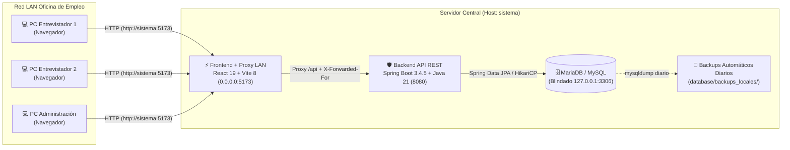

# Bolsa de Trabajo - Oficina de Empleo San José 🏢

Este proyecto constituye el **Trabajo Final** para la **Tecnicatura Universitaria en Programación (TUP)** de la **Facultad Regional Concepción del Uruguay - Universidad Tecnológica Nacional (FRCU UTN)**.

Se trata de una plataforma integral en producción diseñada para la gestión diaria de la **Oficina de Empleo de la Municipalidad de San José**, permitiendo administrar postulantes, currículums estandarizados, historial de entrevistas, relevamiento de empresas locales, estadísticas ejecutivas y administración del equipo de entrevistadores en red local (LAN).

---

## 👥 Integrantes del Grupo
* **Alvarez, Fabricio**
* **Quiroga, Agustin**
* **Ramirez, Emanuel**

---

## 🚀 Arquitectura General y Stack Tecnológico

El sistema implementa una arquitectura desacoplada **Cliente-Servidor en 3 capas**, optimizada para operar con un servidor central en la oficina y múltiples terminales de entrevistadores conectadas a través de la red LAN:



### 1. Backend (Java 21 + Spring Boot 3.4.5)
* **Arquitectura en Capas:** Separación estricta en `Controller`, `Service`, `Repository` y `Entity`/`DTO` bajo el paquete `com.sanjose.bolsatrabajo`.
* **Persistencia y ORM:** **Spring Data JPA** con **Hibernate 6**, validación **Jakarta Bean Validation** (`spring-boot-starter-validation`), pool de conexiones **HikariCP** y políticas de borrado lógico (*Soft Delete*) con reactivación inteligente (*Upsert*).
* **Seguridad Criptográfica:** **Spring Security 6** + **JWT** (`jjwt 0.11.5`) en cookies `HttpOnly` y hashing **BCrypt**.
* **Testing Automatizado:** Suite completa de **28 tests automatizados** (unitarios y de integración) con **JUnit 5**, **Mockito** y **Spring MockMvc**.

### 2. Frontend (React 19 + TypeScript 6 + Vite 8)
* **Interfaz Moderna y Adaptativa:** **React 19** con tipado estricto en **TypeScript 6**, estilizado con variables CSS dinámicas y soporte de **Modo Claro / Oscuro** persistido individualmente por usuario.
* **Sincronización Multi-Entrevistador en Vivo:** Refresco silencioso en segundo plano cada 30 segundos y al recuperar el foco de la ventana para mantener sincronizadas todas las terminales de la oficina sin recargar la página.
* **Exportación Documental:** Generación nativa de Currículum Vitae en formato **A4 listo para imprimir o exportar a PDF** (`html2pdf.js`) y exportación de reportes estadísticos completos en **CSV (Excel)** y **PDF**.

---

## 🧩 Módulos Funcionales del Sistema

### 1. 👥 Gestión de Postulantes y Seguimiento de Entrevistas
* **Búsqueda Instantánea y Filtros Combinados:** Filtrado simultáneo por nombre, apellido, DNI/CUIL, rubro de interés, estado laboral, rango de edad, certificado de discapacidad (CUD), nivel educativo y barrio.
* **Reactivación Inteligente (*Upsert*):** Si se registra un ciudadano cuyo DNI o CUIL había sido dado de baja anteriormente, el sistema restaura automáticamente su legajo histórico y actualiza sus datos.
* **Vista de CV Profesional A4 + Panel Privado del Entrevistador:**
  * Hoja A4 con fotografía, datos de contacto, formación académica, experiencia laboral, habilidades e idiomas.
  * **Autoguardado (*Autosave*):** La calificación por estrellas (`1 a 5`) y las observaciones internas del entrevistador se guardan automáticamente tras 1.5 segundos de inactividad y nunca se imprimen en el CV del ciudadano.
  * **Línea de Tiempo de Visitas:** Registro cronológico de entrevistas con fecha, entrevistador responsable, objetivo, prioridad de inserción y estado del trámite.

### 2. 🏭 Relevamiento de Empresas y Demanda Laboral
* **Padrón Productivo Local:** Registro de comercios, PyMEs e industrias con formateo automático de **CUIT** (`XX-XXXXXXXX-X`), razón social, nombre de fantasía, rubro, dotación de empleados, dirección, barrio y datos de contacto directos (clic para llamar o enviar correo).
* **Semáforo de Demanda de Personal:** Clasificación rápida por interés de contratación (`Busca personal`, `Interés a futuro`, `Sin búsquedas`, `Sin dato`) y adhesión a **Programas Municipales de Empleo**.
* **Trazabilidad y Reactivación por CUIT:** Registra automáticamente qué entrevistador relevó cada empresa y restaura fichas inactivas si se vuelve a relevar un mismo CUIT.

### 3. 📊 Panel de Informes y Estadísticas Unificado (`SuperAdmin`)
Consolida en una única vista ejecutiva las métricas de **Postulantes** (sección superior) y las métricas de **Empresas Relevadas** (sección inferior):
* **Métricas de Postulantes:** Total de activos, altas de los últimos 7 y 30 días, desempeño por entrevistador, distribución por estado laboral, Top 5 barrios, niveles educativos, género, rangos etarios con edad promedio y estadísticas de discapacidad (CUD y tipos).
* **Métricas de Empresas Relevadas:** Total de empresas activas, altas de la última semana y último mes, total buscando personal activamente, relevamientos por entrevistador, distribución por demanda de personal, Top 5 barrios empresariales, empresas por rubro/sector, adhesión a programas de empleo, distribución por localidad y por dotación de empleados (`1-5` a `+200`).
* **Exportación Unificada:** Descarga en 1 clic a **CSV (compatible con Excel)** incluyendo todas las tablas de postulantes y empresas, o impresión directa en **PDF**.

### 4. 🔐 Administración de Personal y Cambio de Contraseñas Individual / Masivo (`SuperAdmin`)
* **Gestión de Operadores:** Creación de cuentas con rol `Entrevistador` o `SuperAdmin`, activación/suspensión instantánea en vivo (`ACTIVO` / `INACTIVO`) y baja lógica sin pérdida de trazabilidad histórica en entrevistas o empresas.
* **Cambio de Contraseñas Individual o Masivo por Rol:** Permite actualizar la clave de:
  * **Un usuario individual** (entrevistador o administrador) elegido desde un selector.
  * **Todos los Entrevistadores** en simultáneo (`ENTREVISTADORES`).
  * **Todos los Administradores** en simultáneo (`ADMINISTRADORES`).
  * **Todo el Personal del sistema** en bloque (`TODOS`).

### 5. ⚙️ Catálogos Centralizados en Red y Manual Interactivo
* **Catálogos Compartidos en el Servidor:** Administración en vivo de **Rubros**, **Barrios**, **Niveles Educativos** y **Estados Laborales** sincronizados centralizadamente en el backend para que todas las PCs de la red LAN compartan exactamente las mismas opciones.
* **Manual de Usuario Integrado:** Guía interactiva paso a paso dentro de la propia aplicación, con buscador de temas y preguntas frecuentes (FAQ).

---

## 📊 Diagrama Entidad-Relación (DER) de la Base de Datos


---

## 🛡️ Seguridad y Hardening de Producción

1. **Sesiones JWT en Cookies `HttpOnly` (`SameSite=Lax`):**
   * Los tokens JWT nunca se exponen en el cuerpo JSON ni en `localStorage`; se gestionan exclusivamente mediante cookies `HttpOnly`, anulando vectores de robo de sesión vía XSS.
2. **Control de Acceso Basado en Roles (RBAC):**
   * Definido en [`SecurityConfig.java`](backend/src/main/java/com/sanjose/bolsatrabajo/config/SecurityConfig.java). Las rutas `/api/stats`, `/api/users/**`, bajas lógicas (`DELETE`) y escritura de catálogos exigen rol `SuperAdmin`.
3. **Revocación Instantánea de Cuentas:**
   * [`UserDetailsServiceImpl.java`](backend/src/main/java/com/sanjose/bolsatrabajo/service/UserDetailsServiceImpl.java) valida en cada petición que `activo == true` y `deletedAt == null`. Si un operador es desactivado, su sesión queda invalidada en el acto.
4. **Rate Limiting por IP Real en Red LAN (`X-Forwarded-For`):**
   * [`AuthController.java`](backend/src/main/java/com/sanjose/bolsatrabajo/controller/AuthController.java) bloquea durante 15 minutos a la IP que supere 5 intentos fallidos de login. Gracias a `xfwd: true` en [`vite.config.ts`](frontend/vite.config.ts), cada computadora de la red LAN se identifica de forma independiente.
5. **Complejidad de Contraseñas y Lista Blanca de Roles:**
   * [`UserController.java`](backend/src/main/java/com/sanjose/bolsatrabajo/controller/UserController.java) exige mínimo 8 caracteres, 1 mayúscula, 1 número y 1 símbolo especial, y valida los roles contra una lista blanca cerrada.
6. **Aislamiento de Base de Datos (`127.0.0.1:3306`) y Protección de PII:**
   * MariaDB se ejecuta con `--bind-address=127.0.0.1`, impidiendo conexiones directas externas desde la LAN.
   * Los DNI y CUIL se ofuscan en los logs del servidor (`****5678`), y todos los volcados con datos reales (`database/backups_locales/`, `*.csv`, `.env`) están excluidos por `.gitignore`.

---

## ⚙️ Operación en Producción Local (Servidor LAN, Auto-Inicio, Watchdog y Backups)

El sistema cuenta con automatización completa para operar como servidor dedicado en Windows sin intervención técnica diaria:

| Script / Herramienta | Función Principal |
| :--- | :--- |
| **`scripts/iniciar-oculto.vbs`** | Lanzador silencioso registrado en el Inicio de Windows (`shell:startup`). Levanta todos los servicios al encender la PC sin abrir ventanas de consola. |
| **`scripts/autostart-services.ps1`** | Orquestador que desactiva la suspensión energética de Windows, inicia **MariaDB** (`127.0.0.1:3306`), ejecuta el backup diario, inicia el **Backend** (`8080`) y publica el **Frontend** en la red LAN (`0.0.0.0:5173`). |
| **Tarea `BolsaTrabajoWatchdog`** | Tarea programada de auto-recuperación (*Self-Healing*) que verifica cada **5 minutos** que los 3 servicios estén activos y levanta automáticamente cualquiera que se haya detenido. |
| **`scripts/backup-db.ps1`** | Genera automáticamente un respaldo SQL diario en `database/backups_locales/backup_automatico_YYYY-MM-DD.sql` y conserva los últimos 30 días. |
| **`respaldar-bd.bat`** | Genera un respaldo manual instantáneo (`backup_manual_YYYY-MM-DD_HH-mm.sql`) con un doble clic. |
| **`actualizar.bat`** | Script de **Despliegue Continuo Local (CD)**: respalda la BD, descarga cambios con `git pull`, recompila el `.jar` de producción y reinicia los servicios automáticamente. |
| **`iniciar.bat` / `detener.bat`** | Permiten iniciar o detener manualmente todos los servicios (pausando el *Watchdog* al detener). |

### 🌐 Acceso desde las Computadoras de la Oficina (Red LAN)
* **Desde la propia PC Servidor:** `http://localhost:5173`
* **Desde las demás PCs de Entrevistadores (LAN):** **`http://sistema:5173`** *(o `http://<IP-LOCAL-SERVIDOR>:5173`)*

---

## 🧪 Pruebas Automatizadas e Integración Continua (CI)

Para ejecutar la suite completa de 28 pruebas unitarias y de integración del Backend:

```bash
cd backend
.\mvnw test
```

Para verificar el tipado estricto TypeScript y la compilación de producción del Frontend:

```bash
cd frontend
npm run build
```

> [!NOTE]
> En [`scripts/github-ci.yml`](scripts/github-ci.yml) se incluye la definición completa del pipeline de Integración Continua para GitHub Actions (auditoría de seguridad anti-PII, contenedor de servicio MySQL 8.0, ejecución de los 28 tests en Java 21 y build de producción en Node 22).
