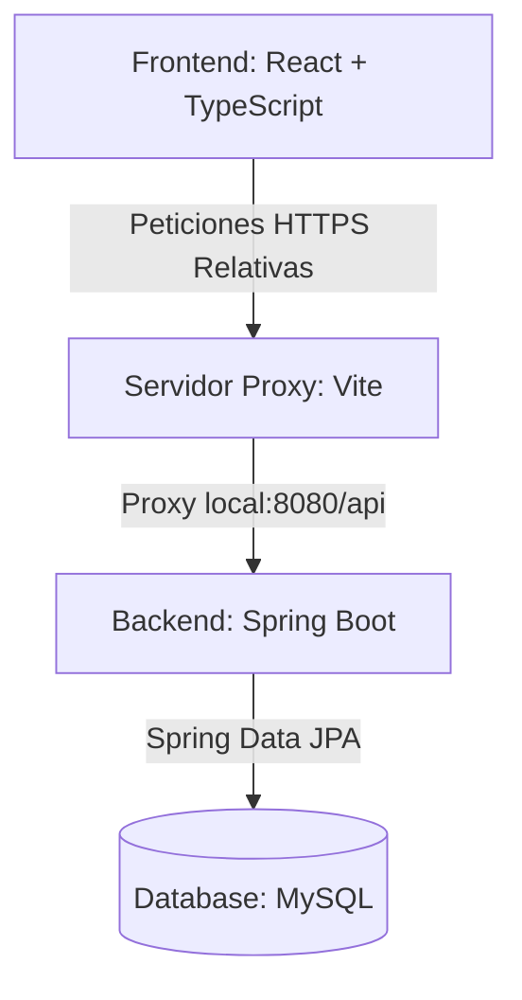
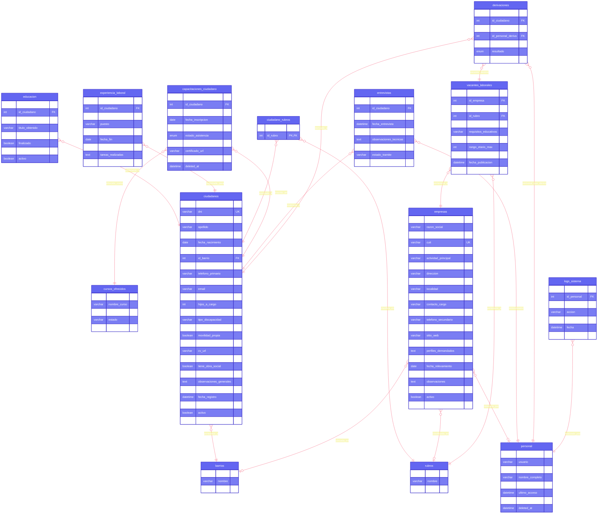

# Bolsa de Trabajo - Oficina de Empleo San José 🏢

Este proyecto constituye el **Trabajo Final** para la **Tecnicatura Universitaria en Programación (TUP)** de la **Facultad Regional Concepción del Uruguay - Universidad Tecnológica Nacional (FRCU UTN)**. 

Se trata de un sistema integral diseñado para la gestión de la Oficina de Empleo de la Municipalidad de la ciudad de San José, permitiendo administrar postulantes, empresas, vacantes, derivaciones laborales y capacitaciones profesionales.

---

## 👥 Integrantes del Grupo
* **Alvarez, Fabricio**
* **Quiroga, Agustin**
* **Ramirez, Emanuel**

---

## 🚀 Características Técnicas y Arquitectura del Sistema

El sistema implementa una arquitectura desacoplada de Cliente-Servidor estructurada de la siguiente manera:



### 1. Backend (Spring Boot)
* **Paquete Base Refacturado:** Toda la estructura de clases del backend ha sido refactorada desde el genérico `com.tuempresa.proyecto` al paquete corporativo representativo del municipio: `com.sanjose.bolsatrabajo`.
* **Motor de Inyección:** Spring Boot 3.4.5 con soporte nativo para Java 21 hasta Java 25.
* **Persistencia y Acceso a Datos:** Spring Data JPA con Hibernate, implementando mapeo objeto-relacional (ORM), transaccionalidad robusta y políticas de borrado lógico (*Soft Delete*) en entidades principales para mantener la integridad histórica.
* **Seguridad y Control de Acceso:** Implementado mediante Spring Security y tokens estructurados firmados criptográficamente (JWT).

### 2. Frontend (React)
* **Framework:** React 19 ejecutado sobre Vite 8 como empaquetador y TypeScript para garantizar la tipicidad estricta.
* **Componentización:** Vanilla CSS utilizando variables HSL y temas personalizados (Modo Claro / Oscuro) con transiciones suaves de color.
* **Generación de Reportes:** Integración de `html2pdf.js` para compilar y generar archivos PDF del currículum de postulantes en formato estándar A4.

---

## 📊 Diagrama Entidad-Relación (DER) del Sistema

La estructura relacional de la base de datos se detalla en el siguiente modelo de relaciones físicas:



---

## 🛡️ Arquitectura y Características de Seguridad (Security Hardening)

El sistema implementa medidas avanzadas de seguridad a nivel de código, de infraestructura y de base de datos, estructuradas y remediadas en base a auditorías exhaustivas de vulnerabilidades:

### 1. Gestión de Sesión y Autenticación Criptográfica (JWT + Cookies)
* **Cookies HttpOnly de Sesión Segura (SameSite=Lax) [SEC-05, SEC-10, SEC-11]:** Las credenciales de sesión (tokens JWT) se almacenan exclusivamente en cookies del navegador marcadas con las propiedades `HttpOnly` y `SameSite=Lax`. Esto garantiza que los scripts del frontend (JavaScript) no tengan acceso al token en memoria, anulando ataques de robo de sesión a través de Scripting en Sitios Cruzados (XSS) e impidiendo el envío no intencionado en peticiones externas (mitigación CSRF).
* **Remoción del Token en Cuerpo de Respuesta [SEC-17]:** Al iniciar sesión con éxito, el servidor responde únicamente con la información básica del perfil del usuario (nombre, rol y usuario) y establece la cookie JWT de sesión de forma transparente, eliminando toda persistencia local del token en el cliente.
* **Filtros JWT Desacoplados:** El componente [JwtFilter.java](file:///c:/Users/alvar/OneDrive/Documentos/GitHub/backend/src/main/java/com/sanjose/bolsatrabajo/filter/JwtFilter.java) analiza de manera automática tanto las cabeceras HTTP como las cookies de red para autenticar peticiones sin requerir código intrusivo.

### 2. Control de Acceso y Hardening de Endpoints
* **Control de Acceso Basado en Roles (RBAC) [SEC-06]:** Configurado centralmente en [SecurityConfig.java](file:///c:/Users/alvar/OneDrive/Documentos/GitHub/backend/src/main/java/com/sanjose/bolsatrabajo/config/SecurityConfig.java). Los accesos a estadísticas avanzadas y gestión de personal están restringidos únicamente a cuentas con rol `SuperAdmin`.
* **Permisos Granulares en Catálogos:** Las lecturas de zonas/rubros están abiertas a roles de `Entrevistador`, mientras que las escrituras y modificaciones están protegidas exclusivamente para `SuperAdmin`.
* **Desactivación Inmediata de Acceso [SEC-16]:** El servicio [UserDetailsServiceImpl.java](file:///c:/Users/alvar/OneDrive/Documentos/GitHub/backend/src/main/java/com/sanjose/bolsatrabajo/service/UserDetailsServiceImpl.java) comprueba en cada autenticación si la cuenta del personal posee el estado activo (`activo = true`) y no cuenta con registros de eliminación (`deletedAt == null`), interrumpiendo sesiones abiertas de forma instantánea si el administrador suspende al operario.

### 3. Protección de Datos y Cuentas (Hardening de Entrada)
* **Políticas de Complejidad de Contraseñas [SEC-14]:** Los endpoints de alta y modificación de claves en [UserController.java](file:///c:/Users/alvar/OneDrive/Documentos/GitHub/backend/src/main/java/com/sanjose/bolsatrabajo/controller/UserController.java) exigen requisitos estrictos de contraseña (longitud mínima de 8 caracteres, al menos una mayúscula, un número y un carácter especial).
* **Limitación de Intentos (Rate Limiting) [SEC-13]:** Implementado en el login un sistema de bloqueo por IP que bloquea las solicitudes durante 15 minutos tras 5 intentos fallidos consecutivos, previniendo ataques de fuerza bruta o diccionario.
* **Lista Blanca de Roles [SEC-15]:** Validación forzada contra un listado estático preaprobado en el backend antes de asignar un rol a un operador, previniendo la escalada de privilegios por inyección de roles no válidos.

### 4. Privacidad de Datos de Postulantes (PII & Archivos)
* **Enmascaramiento de Datos Sensibles (Logs) [SEC-18]:** El servicio [CiudadanoService.java](file:///c:/Users/alvar/OneDrive/Documentos/GitHub/backend/src/main/java/com/sanjose/bolsatrabajo/service/CiudadanoService.java) ofusca información de identificación personal (DNI y CUIL) en los logs del servidor (ej: `****5678`), evitando fugas de PII en auditorías de infraestructura.
* **Restricción de Serialización de Contraseñas [SEC-04]:** Uso de anotaciones Jackson para definir el hash de la clave de usuario como propiedad únicamente de escritura (`Access.WRITE_ONLY`), evitando su exposición en payloads JSON de lectura.
* **Validación de Carga de Archivos (Foto) [SEC-20]:** El campo fotografía es controlado para impedir ataques de denegación de servicio (DoS) por inyección de payloads de gran tamaño, validando cabeceras de tipo MIME de imagen (`data:image/`) y limitando el tamaño en Base64 a un máximo de 2 MB.

### 5. Configuración e Infraestructura Segura
* **Externalización de Credenciales y Secretos [SEC-08, SEC-09, SEC-02]:** Separación completa de secretos de base de datos y llaves de firma JWT en propiedades externas del entorno, requiriendo el uso de variables de entorno y eliminando contraseñas por defecto (como `admin`) del código fuente.
* **Perfiles Locales y GitIgnore Seguro [SEC-19]:** Configuración de [.gitignore](file:///c:/Users/alvar/OneDrive/Documentos/GitHub/.gitignore) estructurada para excluir de forma robusta dependencias locales (`node_modules/`), variables de entorno locales (`.env*`), propiedades del sistema de base de datos y archivos de logs del servidor.

---

## ⚙️ Parámetros de Configuración y Variables de Entorno

El backend lee variables críticas de entorno o configuraciones del archivo [application.properties](file:///c:/Users/alvar/OneDrive/Documentos/GitHub/backend/src/main/resources/application.properties):

| Propiedad / Variable de Entorno | Propósito | Configuración Local / Recomendada |
| :--- | :--- | :--- |
| `spring.datasource.url` | Dirección JDBC de conexión de base de datos | `jdbc:mysql://localhost:3306/oficina_empleo_sanjose` |
| `spring.datasource.username` | Usuario de la base de datos | `<TU_USUARIO_MYSQL>` |
| `spring.datasource.password` | Contraseña de la base de datos | `<TU_CONTRASEÑA_MYSQL>` |
| `app.security.jwt.secret` | Clave secreta para firmar tokens JWT (env: `JWT_SECRET`) | `<TU_SECRETO_JWT_SEGURO>` |
| `app.security.superadmin.password`| Contraseña del superadmin inicial (env: `SUPERADMIN_PASSWORD`)| Generada aleatoriamente si no se provee |
| `app.security.cors.allowed-origins`| Origen de peticiones frontend (env: `ALLOWED_ORIGINS`) | `http://localhost:5173` |

---

## ⚡ Puesta en marcha rápida en una PC nueva (Sin nada instalado)

Si clonás este repositorio en una computadora limpia (sin Java, sin Node.js, sin MySQL):

### Opción A — Con Antigravity (La más fácil 🤖)
1. Abrí esta carpeta del proyecto en **Antigravity**.
2. Escribile en el chat:
   > *"Hola, acabo de clonar este proyecto en esta máquina limpia. Ejecutá el script de instalación automática y dejá corriendo el backend y el frontend."*
3. Antigravity detectará el sistema operativo, ejecutará los instaladores desatendidos vía `winget`, configurará el entorno e iniciará los servicios por vos.

### Opción B — Script Automático para Windows (1 Clic)
1. Hacé doble clic en **`setup.bat`** (o ejecutá `powershell ./scripts/setup-windows.ps1`).
   * Instala automáticamente **Node.js LTS** y **Microsoft OpenJDK 21** vía `winget`.
   * Inicializa la configuración de base de datos y crea `backend/.env`.
   * Ejecuta `npm install` en el frontend.
2. Para iniciar todo el sistema: hacé doble clic en **`iniciar.bat`**.
   * Levanta el Backend en puerto 8080 y el Frontend en puerto 5173.
   * Abre automáticamente el navegador en [http://localhost:5173](http://localhost:5173).

### Opción C — Con Docker Desktop (100% Aislado y Portátil)
Si la máquina tiene **Docker Desktop**:
```bash
docker compose up -d --build
```
* Levanta MySQL 8.0 (con la base de datos importada automáticamente desde `database/BD_oficinadeempleo.sql`).
* Levanta el Backend Spring Boot en el puerto 8080.
* Levanta el Frontend React en el puerto 5173 / 80.
* No requiere instalar Java, Node ni MySQL en la computadora host.

---

## 🛠️ Requisitos e Instalación Manual del Proyecto

### Requisitos Previos
* **Java 21+** (Compatible y verificado en JDK 25)
* **Node.js 20+**
* **MySQL 8.0+**
* **Maven 3.9+** (o el wrapper `mvnw` incluido)

### 1. Configuración de Base de Datos
1. Crea la base de datos local `oficina_empleo_sanjose`.
2. Ejecuta el script SQL [BD_oficinadeempleo.sql](file:///c:/Users/alvar/OneDrive/Documentos/GitHub/database/BD_oficinadeempleo.sql) para inicializar las tablas maestros e integridad referencial.
3. *(Opcional)* Si requieres migrar planillas previas o corregir codificaciones UTF-8 en datos heredados, puedes ejecutar los scripts del directorio `database`:
   * [import_excel.py](file:///c:/Users/alvar/OneDrive/Documentos/GitHub/database/import_excel.py)
   * [fix_db_encoding.py](file:///c:/Users/alvar/OneDrive/Documentos/GitHub/database/fix_db_encoding.py)

### 2. Despliegue del Servidor Backend
1. Ubícate en el directorio `backend/`.
2. Compila el código del proyecto y corre las pruebas unitarias:
   ```bash
   # En Windows:
   .\mvnw clean test
   
   # En Linux/Mac:
   ./mvnw clean test
   ```
   > [!IMPORTANT]
   > Si ejecutas las pruebas utilizando Java 25+, se requiere el argumento JVM de habilitación de agentes dinámicos de Mockito, el cual está configurado automáticamente en el [pom.xml](file:///c:/Users/alvar/OneDrive/Documentos/GitHub/backend/pom.xml) bajo la directiva `<argLine>-XX:+EnableDynamicAgentLoading</argLine>`.
3. Inicia el servidor Spring Boot en puerto `8080`:
   ```bash
   .\mvnw spring-boot:run
   ```

### 3. Despliegue del Cliente Frontend
1. Accede a la carpeta `frontend/`.
2. Instala los paquetes y dependencias del sistema:
   ```bash
   npm install
   ```
3. Ejecuta el servidor local de desarrollo en puerto `5173`:
   ```bash
   npm run dev
   ```
4. Abre [http://localhost:5173](http://localhost:5173) en tu navegador e inicia sesión con el usuario `superadmin`.

